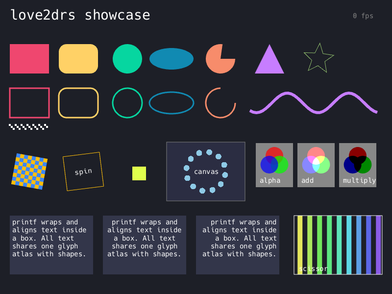
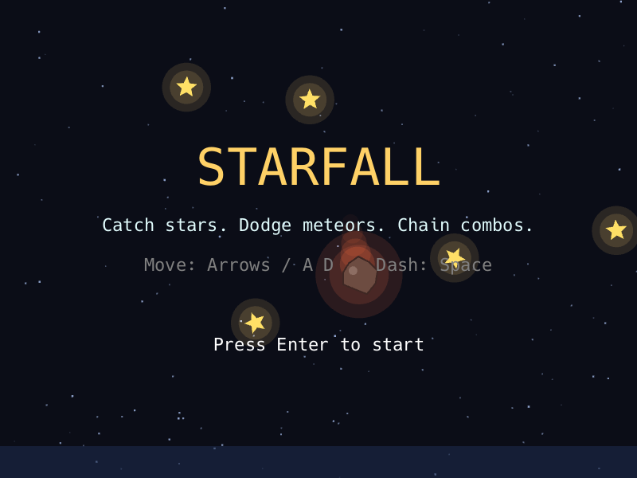
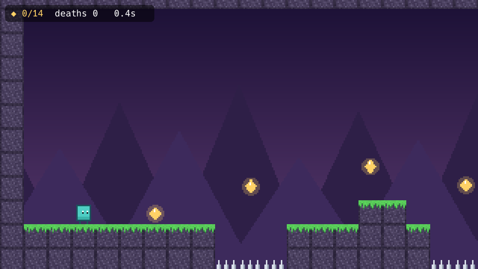
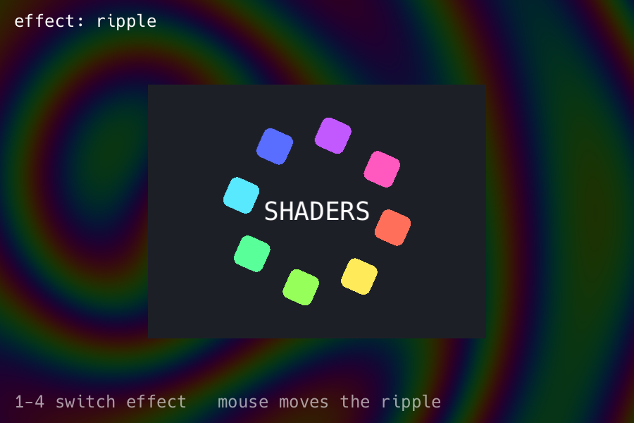

# love2drs

A [LÖVE](https://love2d.org)-inspired 2D game framework for Rust. It has the same small API (`update` / `draw` callbacks, immediate-mode drawing, `push`/`pop` transforms), and it runs on a batched [wgpu](https://wgpu.rs) renderer that handles hundreds of thousands of sprites.

```rust
use love2drs::prelude::*;

struct Hello {
    pos: Vec2,
}

impl Game for Hello {
    fn update(&mut self, ctx: &mut Context, dt: f32) {
        let kb = &ctx.keyboard;
        let dir = vec2(kb.axis(Key::Left, Key::Right), kb.axis(Key::Up, Key::Down));
        self.pos += dir.normalize_or_zero() * 300.0 * dt;
    }

    fn draw(&mut self, ctx: &mut Context) {
        let g = &mut ctx.graphics;
        g.set_color(Color::hex(0xff6688));
        g.circle(Fill, self.pos.x, self.pos.y, 40.0);
        g.set_color(Color::WHITE);
        g.print("Hello from love2drs!", 20.0, 20.0);
    }
}

fn main() -> love2drs::Result {
    love2drs::run(Conf::new("Hello"), |_ctx| Ok(Hello { pos: vec2(400.0, 300.0) }))
}
```

| | |
|---|---|
## Installation

```toml
[dependencies]
love2drs = { git = "https://github.com/gccody/Love2DRS" }

# Recommended: compile dependencies (wgpu, image decoding, audio) with optimizations
# even in debug builds. Without this, `cargo run` builds of your game can be very slow.
[profile.dev.package."*"]
opt-level = 2
```

Cargo only applies `[profile.*]` settings from your own `Cargo.toml`, not from a
dependency's, so this has to go in your game's manifest. Rust 1.88 or newer is required.

love2drs runs on Windows, macOS, Linux (X11 and Wayland), [Android and iOS](#android-and-ios). On Linux, building needs a few
system headers: `sudo apt install pkg-config libudev-dev libasound2-dev` on Debian/Ubuntu, or
`sudo dnf install pkgconf systemd-devel alsa-lib-devel` on Fedora. `libudev-dev` is for the
`gamepad` feature and `libasound2-dev` for `audio`; drop either feature to skip its headers.

|  |  |
|  |  |

## Examples

```sh
cargo run --example hello                     # the snippet above
cargo run --example showcase                  # tour of the drawing API
cargo run --release --example starfall        # arcade game: catch stars, dodge meteors
cargo run --release --example platformer      # pixel-art platformer (canvas + sprite batch)
cargo run --example shaders                   # custom WGSL pixel shaders / post effects
cargo run --example input                     # gamepad / touch / event tester
cargo run --example mobile                    # touch, rotation, assets and saving, for phones
cargo run --release --example spritemark -- 100000   # renderer stress test
```

Apart from the logo in `mobile`, the examples generate their art and sound in code, so they don't need asset files.

## What's in the box

| LÖVE | love2drs |
|---|---|
| `love.load` | the closure passed to `love2drs::run` |
| `love.update(dt)` / `love.draw()` | `Game::update` / `Game::draw` |
| `love.keypressed`, `mousepressed`, `textinput`, `wheelmoved`, `resize`, `focus`, `quit`, ... | `Game::key_pressed`, `mouse_pressed`, `text_input`, `wheel_moved`, `resize`, `focus`, `quit`, ... |
| `love.gamepadpressed`, `gamepadaxis`, `joystickadded`, `touchpressed`, `touchmoved`, ... | `Game::gamepad_pressed`, `gamepad_axis`, `gamepad_added`, `touch_pressed`, `touch_moved`, ... |
| `love.graphics` | `ctx.graphics`: shapes, images, quads, text, canvases, sprite batches, meshes, shaders, blend modes, scissor, transform stack, screenshots |
| `love.keyboard` / `love.mouse` | `ctx.keyboard` / `ctx.mouse` (`is_down`, `was_pressed`, `axis`, position, wheel, grab, ...) |
| `love.joystick` | `ctx.gamepad`: hot-plugged controllers in an Xbox-style layout (buttons, sticks, triggers, rumble) via [gilrs](https://crates.io/crates/gilrs) |
| `love.touch` | `ctx.touch`: every finger on a touchscreen (position, start, delta, pressure) |
| `love.audio` | `ctx.audio` (wav/ogg/mp3/flac, volume, pitch, looping, seek, overlapping SFX, synthesized sounds) |
| `love.timer` | `ctx.timer` (`delta`, `fps`, `time`) |
| `love.window` | `ctx.window` (title, size, fullscreen, ...) |
| `love.math` | `love2drs::math` (`random*`, seedable `Rng`, `noise2`, `Transform`, `Vec2`) |
| `love.filesystem` | `love2drs::filesystem` (`read`, `save_dir`) |
| `love.lowmemory`, app suspend and resume | `Game::low_memory`, `suspended`, `resumed` |
| `conf.lua` | `Conf::new("title").size(1280, 720).msaa(4).vsync(false)` |

Some differences from LÖVE:

- **A minimized game keeps running at 30 fps.** Nothing is drawn to the screen, but `update`,
  input and audio carry on. Check `ctx.window.is_minimized()` to pause instead.

- **Optional arguments become builders.** `love.graphics.draw(img, x, y, r, sx, sy, ox, oy)` is
  `g.draw_ex(&img, DrawParams::at(x, y).rotation(r).scale(2.0).centered())`. The plain
  `g.draw(&img, x, y)` covers the common case.
- **Shaders are WGSL.** You write only an `effect` function, as in LÖVE; love2drs provides the vertex
  stage, the bindings and 16 `vec4` uniform slots (`shader.send(slot, value)`). See `examples/shaders.rs`.
- **Coordinates are logical pixels.** Text is rasterized at the physical resolution and at the scale it
  is drawn, so it stays sharp on HiDPI screens and when scaled.
- **Keys are physical keys.** `Key::W` is the same key on QWERTY and AZERTY. Use `text_input` for typed text.
- **Colors are 0..1** (LÖVE 11 convention), and blending happens in gamma space as in LÖVE.

## Performance

Draw calls are never sent to the GPU directly:

- Sprites, glyphs and shapes are recorded as 48-byte quad/triangle instances that the vertex shader
  expands, instead of four vertices plus six indices (104 bytes). Consecutive draws that share a
  texture, blend mode, shader and scissor are merged into a single GPU draw call. At the end of the
  frame everything is uploaded with one `write_buffer` per buffer.
- Drawing with the same texture as the previous draw costs one comparison and a `Vec` push; state
  changes are handled on a separate slow path.
- Shapes sample a white texel inside the glyph atlas, so rectangles, circles and text **batch together**.
- All text, in any font and size, shares one glyph atlas that is rasterized on demand.
- `SpriteBatch` keeps static geometry (tile maps) on the GPU between frames. It is only re-uploaded when
  it changes, and is drawn with one draw call that can still be transformed.
- Rotations use a fast polynomial `sin_cos`. The hot paths are `#[inline]` so they inline into your crate.

`spritemark` draws every sprite with an individual, rotated, tinted `draw_ex` call. Measured on the
development machine (release build, vsync off):

| sprites | fps | GPU draw calls |
|---:|---:|---:|
| 30,000 | ~1,100 | 2 |
| 100,000 | ~375 | 2 |
| 200,000 | ~190 | 2 |

At 100,000 sprites a frame is roughly 1.5 ms of recording the draws, 0.8 ms of uploading the
instances (48 bytes per sprite) and 0.25 ms of the example's own update loop.
For geometry that doesn't move, a `SpriteBatch` avoids that cost entirely.

## Android and iOS

Add one line next to `fn main`. It does nothing on other platforms:

```rust
fn main() -> love2drs::Result {
    love2drs::run(Conf::new("Hello"), |_ctx| Ok(Hello { pos: vec2(200.0, 300.0) }))
}

love2drs::android_main!(main);
```

Then build, install and run the game with the `cargo-love2drs` tool:

```sh
cargo install --git https://github.com/gccody/Love2DRS cargo-love2drs

cargo love2drs android run                    # on a connected phone or running emulator
cargo love2drs android build --release        # makes an .apk for arm64 and x86_64
cargo love2drs ios run                        # on the iOS Simulator
cargo love2drs ios build --physical --release # makes an .app for a real iPhone or iPad
```

Add `--bin <name>` or `--example <name>` to choose what to build. Inside this repo no install is
needed, so try `cargo love2drs android run --example mobile`. `cargo love2drs` with no arguments
lists every option. Apps are written to `target/love2drs/`.

**What you need:**

- **Android**, on any desktop OS: the Android SDK and NDK from Android Studio's SDK Manager, a JDK, and
  `rustup target add aarch64-linux-android x86_64-linux-android`. Gradle isn't needed. Android 8 (API 26) or newer.
- **iOS**, on macOS only: Xcode, and `rustup target add aarch64-apple-ios aarch64-apple-ios-sim`.
  iOS 15 or newer. To install on a real device, pass `--device <UDID> --identity <NAME> --profile <PATH>`
  with a signing identity and provisioning profile from your Apple developer account.

**App settings** go in your game's `Cargo.toml`. All of them are optional:

```toml
[package.metadata.love2drs]
app_id = "com.example.mygame"    # default: com.love2drs.<name>
name = "My Game"                 # default: the Cargo name
assets = ["assets"]              # directories or files to package, from the package root
orientation = "landscape"        # landscape, portrait or any (the default)
icon = "assets/icon.png"         # square PNG, 1024x1024 is best; default: the OS's blank icon
version_code = 3                 # default: derived from the version, 1.2.3 becomes 10203
min_sdk = 26                     # Android
target_sdk = 36                  # Android
permissions = ["android.permission.INTERNET"]  # Android
ios_deployment_target = "15.0"   # iOS
```

**How a phone differs from a desktop:**

- **The window always fills the screen**, so `Conf::size` is ignored. Lay out from `ctx.graphics.width()`
  and `height()`, handle `Game::resize` for rotation, and keep controls inside `ctx.window.safe_area()`,
  away from notches and gesture bars. Most of the bundled examples use fixed desktop layouts and get
  clipped on a phone; `examples/mobile.rs` is the one written for it.
- **Touch is the main input.** The first finger also acts as the left mouse button, so mouse-only games
  work, and Android's back gesture arrives as `Key::Escape`.
- **Controllers** use the same `ctx.gamepad` API as on desktop, including rumble. Whether a controller
  can rumble depends on the controller and OS version, so check `is_vibration_supported()`. Android needs
  no permission prompt for this; the tool declares `VIBRATE` for you.
- **The on-screen keyboard** opens with `ctx.keyboard.set_screen_keyboard(true)`. Typing reaches `text_input`,
  and `Key::Backspace` and `Key::Enter` reach `key_pressed`. `safe_area()` shrinks while it's up, so keep your text
  field inside that. The user can close it without the game finding out, so show it again when a text field is
  tapped. On Android, love2drs only receives text that maps to key presses, which covers Latin letters, digits
  and punctuation. Emoji, other scripts and autocorrect or swipe typing may not arrive. iOS has no such limit.
- **Files:** `new_image("assets/player.png")` and the other loaders find packaged assets at the same
  path as on desktop. For your own data files, use `love2drs::filesystem::read`, because `std::fs` can't
  see packaged files. The working directory is `love2drs::filesystem::save_dir()`, so writing to a relative path
  with `std::fs` saves there.
- **The OS can end the app at any time** once it's in the background. `Game::suspended` is your last chance to
  save. `update` and `draw` stop and sounds are silenced until `Game::resumed`.
- **`ctx.quit()` ends the app**, even on iOS, where apps normally don't quit themselves. Apple's review guidelines
  discourage offering this, so don't show a quit button in an iOS game.
- **Logs:** on Android, `log` output goes to logcat under the `love2drs` tag, and `cargo love2drs android run` follows it.
  On iOS, nothing collects `log` output unless you install a logger, but panics and startup errors reach stderr,
  which `cargo love2drs ios run` shows.

**Not supported yet:** store packaging. Google Play needs an `.aab`, which the tool doesn't make, and App Store
uploads need an `.ipa` from Xcode.

## Cargo features

| feature | default | |
|---|---|---|
| `audio` | yes | sound via [rodio](https://crates.io/crates/rodio) (wav, ogg vorbis, mp3, flac) |
| `gamepad` | yes | controllers and rumble on every platform; without it `ctx.gamepad` reports none |
| `png` | yes | PNG decoding and screenshots |
| `jpeg` | yes | JPEG decoding |

`cargo build --no-default-features` gives you a graphics-only build. Touch input needs no feature.

### Platform notes for input

- **Gamepads** work on Windows (Windows.Gaming.Input), macOS (IOKit) and Linux (evdev). Controller
  input keeps arriving while the window is unfocused or minimized, so a button let go in the
  background is never left stuck down. Check `ctx.window.has_focus()` if your game should ignore it.
  Linux users need read access to `/dev/input/event*`, which desktop distributions grant to the
  logged-in user.
  Rumble works on Windows and Linux. PlayStation controllers (DualShock 4, DualSense, DualSense
  Edge) rumble on Windows and macOS too, over USB or Bluetooth: love2drs reads and drives them
  directly over HID there, since the OS gamepad APIs can't rumble them. Other controllers can't
  rumble on macOS, so `set_vibration` returns `false` for them.
  Android reads controllers through its input queue and Java APIs, and iOS through the GameController and
  CoreHaptics frameworks. On both, held buttons are released and rumble stops when the app is suspended.
- **Touch** events come from touchscreens on Android, iOS, Windows and Linux. macOS has no touchscreens:
  trackpad gestures arrive as mouse and wheel events, so `ctx.touch` stays empty there. The first finger
  also drives emulated mouse events, so a tap reaches both `touch_pressed` and `mouse_pressed`.

## Screenshot testing

Set `LOVE2DRS_SCREENSHOT=out.png` (and optionally `LOVE2DRS_SCREENSHOT_FRAME=60`) to make any
love2drs game save that frame as a PNG and exit. This is useful for CI smoke tests. All the screenshots
above were captured this way. In game code, call `ctx.graphics.capture_screenshot("shot.png")`.

## Agent skill

The repo includes an [Agent Skill](skills/love2drs/SKILL.md) that teaches coding agents the love2drs API,
its gotchas and a set of tested recipes. To install it in Claude Code:

```text
/plugin install love2drs --marketplace gccody/Love2DRS
```

On Claude Code versions before 2.1.275, run `/plugin marketplace add gccody/Love2DRS`, then
`/plugin install love2drs@love2drs`. You can also copy `skills/love2drs/` into your project's
`.claude/skills/` or into `~/.claude/skills/`.

## Project layout

```
src/
  app.rs            event loop, Context, Game trait, run()
  conf.rs           Conf (window/startup options)
  filesystem.rs     reading packaged files, the save directory
  platform.rs       Android and iOS startup, android_main!
  graphics/
    mod.rs          Graphics: the immediate-mode drawing API + batching
    renderer.rs     frame recording structures and the wgpu backend
    font.rs         fonts, text layout and the shared glyph atlas
    image.rs        Image, ImageData, Quad, filter/wrap modes
    spritebatch.rs  retained GPU sprite batches
    shader.rs       custom WGSL shaders and uniforms
    params.rs       DrawParams
    color.rs        Color
  input/            keyboard and mouse
  audio.rs          lock-free sources mixed by rodio
  math.rs           Transform, RNG, noise, fast sin_cos
  timer.rs, window.rs
examples/           runnable demos and games
tools/cargo-love2drs/  packages games for Android and iOS
skills/love2drs/    agent skill (SKILL.md + API reference + recipes)
```

## Roadmap ideas

Store packaging, full text input on Android, streaming playback for long music tracks,
stencil support, multiple render targets, a retained `Text` object, a save directory on desktop, and
WebAssembly support.

## License

love2drs is dual-licensed under [MIT](LICENSE-MIT) or [Apache-2.0](LICENSE-APACHE), at your option. The bundled default font,
[Hack](https://sourcefoundry.org/hack/), is under the MIT License and the Bitstream Vera License; see
`src/graphics/default_font/LICENSE.txt`.
